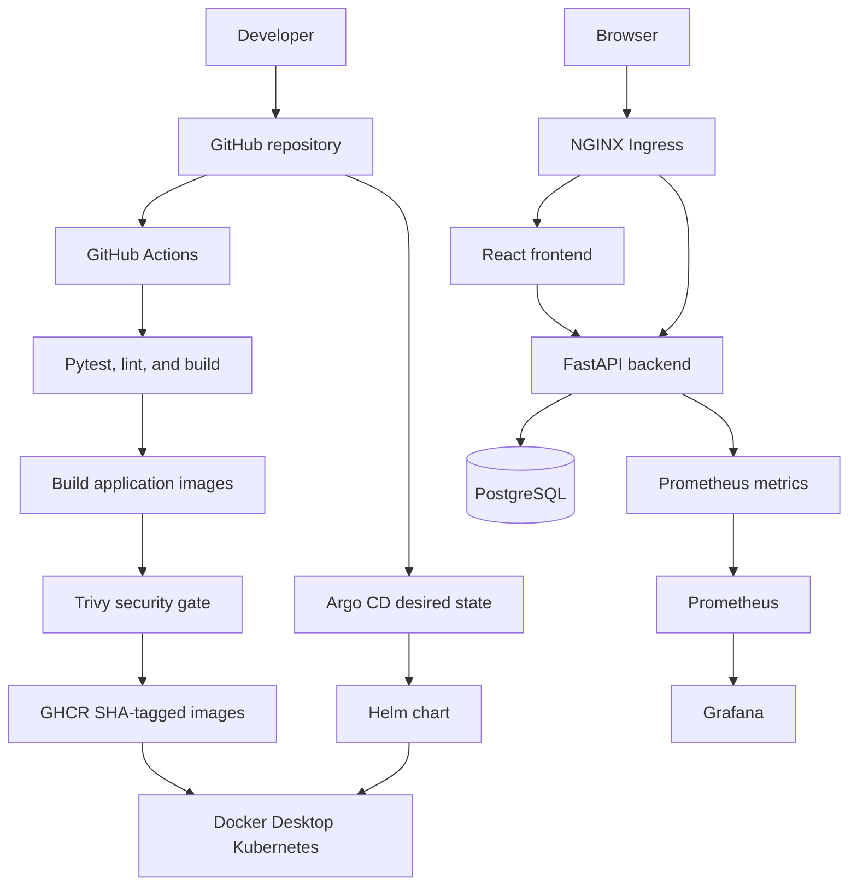
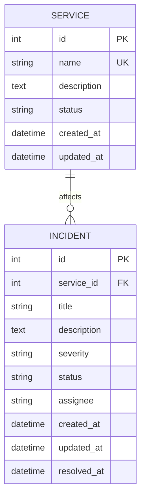
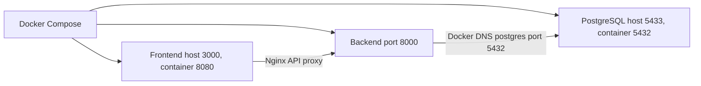

# IncidentOps Architecture

## System purpose

IncidentOps is a modular-monolith incident and service reliability application. It combines a React operations dashboard, a FastAPI REST API, and PostgreSQL with delivery through Docker, GitHub Actions, GHCR, Terraform, Kubernetes, Helm, and a final local Argo CD GitOps supplement.

## Delivery and runtime flow



The GitHub Actions workflow deliberately stops after publishing verified images. The historical M10 deployment was a controlled manual Helm upgrade. Argo CD was added later as a separate local Docker Desktop demonstration of Git desired state to Helm reconciliation; it was not used for the earlier AWS/EKS run.

## Application components

### Frontend

- React and Vite single-page dashboard.
- Central API client under `frontend/src/services/`.
- Service and incident CRUD, filters, lifecycle controls, KPI cards, and SLA state.
- Same-origin `/api` calls in container and Kubernetes environments.
- Explicit loading, empty, validation, backend-error, and retry states.
- Multi-stage Node build with an unprivileged Nginx runtime on port 8080.

### Backend and implemented API

- FastAPI with separate routers, schemas, ORM models, configuration, database access, and SLA policy logic.
- SQLAlchemy 2.x ORM with Alembic-controlled schema evolution.
- Pydantic validation for service state, incident severity, and incident lifecycle.
- Structured application output to stdout/stderr for container collection.

| Method | Route | Purpose |
|---|---|---|
| GET | `/` | API identity and endpoint links |
| GET | `/health` | Process liveness |
| GET | `/ready` | Database-aware readiness |
| GET | `/metrics` | Prometheus metrics |
| GET/POST | `/api/services` | List and create services |
| GET/PUT/DELETE | `/api/services/{id}` | Read, update, and delete a service |
| GET/POST | `/api/incidents` | List/filter and create incidents |
| GET/PUT/DELETE | `/api/incidents/{id}` | Read, update, and delete an incident |
| GET | `/api/incidents/stats` | Database-derived dashboard statistics |

Liveness and readiness are separate by design. `/health` proves the process can respond, while `/ready` performs a database query and prevents traffic from reaching an API with an unavailable dependency.

## Data model



Service status values are Operational, Degraded, Major Outage, and Maintenance. Incident severities are P1 Critical through P4 Low; lifecycle states are Open, Acknowledged, Investigating, and Resolved. Resolving an incident sets `resolved_at`, reopening it clears that timestamp, and the service foreign key uses restricted deletion to preserve incident history.

## Database and migrations

PostgreSQL 17 is used in development, CI, Compose, local Kubernetes, and the completed EKS evidence run. Alembic creates both domain tables, constraints, and incident indexes. Host-run development reaches Compose PostgreSQL on `localhost:5433`; containers use `postgres:5432`.

Tests use a dedicated PostgreSQL database whose name must end with `_test`. The fixture applies the real migration chain, overrides the FastAPI database dependency, and clears rows around every test.

## Containers and local development



Compose uses health-based dependency ordering. The backend runs as UID/GID 10001, the frontend runtime runs as UID/GID 101, and both images have CPU-efficient health probes. Backend startup applies migrations before Uvicorn begins accepting requests.

## CI/CD and supply chain

The pipeline runs on pushes and pull requests to `main`:

1. Start an ephemeral PostgreSQL service.
2. Install backend dependencies and run 16 Pytests.
3. Install frontend dependencies, lint, and build.
4. Build backend and frontend runtime images.
5. Scan both images with Trivy and fail on HIGH/CRITICAL findings.
6. On successful `main` pushes, publish both images to GHCR using the full Git commit SHA.

Pull requests never publish. No `latest` tag is produced. Workflow permissions default to repository-content read access, with package write access limited to the publishing job.

## Terraform and verified AWS topology

Terraform owns the following short-lived academic environment:

- One dedicated `10.0.0.0/16` VPC.
- Two public `/24` subnets in separate `ap-south-1` Availability Zones.
- Internet Gateway, public route table, route, and associations.
- EKS control plane with public access restricted to an operator `/32` and private endpoint access enabled.
- One managed `t3.medium` node target with min/desired/max scaling of 1/1/2 and a 20 GiB root disk.
- Cluster, node, and EBS CSI IAM roles and policy attachments.
- EKS Pod Identity Agent, EBS CSI add-on, and Pod Identity association.

The design intentionally contains no NAT Gateway, RDS/Aurora, ElastiCache, Elastic IP, Route 53 hosted zone, standalone EC2 instance, or AWS Load Balancer. It is an academic cost-conscious topology, not a production network reference.

The verified evidence run used EKS 1.36. The initial plan was 21 add, 0 change, 0 destroy. The cluster, node group, and worker became Active/Ready; IncidentOps and its EBS-backed PostgreSQL PVC worked; and evidence was captured. Application workloads were then uninstalled and Terraform completed 0 add, 0 change, 21 destroy. The final Terraform state list was empty.

Terraform state, backups, plans, `.terraform/`, kubeconfig, and real variable files remain local and Git-ignored.

## Kubernetes and Helm

The `incidentops` chart contains:

- Two-replica backend Deployment, ClusterIP Service, probes, resources, and HPA.
- Two-replica frontend Deployment, ClusterIP Service, probes, and generated Nginx configuration.
- PostgreSQL StatefulSet, Secret, Service, and 1 GiB `ReadWriteOnce` PVC.
- Revision-scoped Alembic migration Job and backend schema-wait init containers.
- Hostless NGINX Ingress routing `/api` to the backend and `/` to the frontend.
- ServiceMonitor for Prometheus discovery.

The chart was linted, rendered, installed locally, installed on EKS, and upgraded successfully. Local and AWS deployments use the same templates; image SHAs and install-time secrets are supplied through values or explicit Helm overrides.

The PostgreSQL container sets `PGDATA=/var/lib/postgresql/data/pgdata` so an EBS filesystem containing `lost+found` can be mounted safely at `/var/lib/postgresql/data`.

## Argo CD GitOps supplement

The source-controlled `argocd/application.yaml` points Argo CD at this repository's `helm/incidentops` chart. The application reconciles into the separate `incidentops-gitops` namespace on Docker Desktop, with both images pinned to the verified M10 SHA. Automated synchronization, pruning, and self-healing are enabled only for that isolated namespace. Ingress, HPA, and ServiceMonitor resources are disabled for the GitOps copy to avoid conflicts with the existing `incidentops` release.

This supplement proves the Git-to-Argo-CD-to-Helm-to-Kubernetes path. The AWS/EKS evidence remains an accurate record of a controlled manual Helm deployment and was destroyed after capture.

## Autoscaling and observability

The backend HPA has a minimum of two replicas, maximum of five, and 50% CPU target. CPU requests provide the denominator for utilization, and Metrics Server provides resource metrics. Controlled local load demonstrated scaling from 2 to 4 to 5 replicas.

`prometheus-fastapi-instrumentator` exposes request count, response status, and latency metrics. A selector-scoped ServiceMonitor connects the backend to kube-prometheus-stack. Grafana provisions the IncidentOps Observability dashboard from source-controlled values with request-rate, p95-latency, and 5xx-rate panels.

## Troubleshooting exercises

Two isolated exercises use dedicated names and labels:

1. A nonexistent image tag produces `ImagePullBackOff`; Pod state, `describe`, and events expose the pull failure.
2. A healthy Pod listens on port 8080 while its Service incorrectly forwards to `targetPort: 9999`; Service, EndpointSlice, Pod-port inspection, and failed requests identify the mismatch before it is corrected.

The exercises were reproduced, diagnosed, recovered, and cleaned up without changing the Helm-managed release.

## Final repository structure

```text
IncidentOps/
├── .github/workflows/ci-cd.yml
├── argocd/                    # Local Argo CD Application and instructions
├── backend/
│   ├── alembic/versions/
│   ├── app/api/
│   ├── app/domain/
│   ├── app/models/
│   ├── app/schemas/
│   ├── tests/
│   ├── Dockerfile
│   └── requirements.txt
├── demo/                      # Final video and presentation artifacts
├── docs/images/               # README application screenshot
├── evidence/
├── frontend/
│   ├── src/components/
│   ├── src/services/
│   ├── Dockerfile
│   └── nginx.conf
├── helm/incidentops/
├── k8s/namespace.yaml
├── monitoring/kube-prometheus-stack-values.yaml
├── terraform/
├── troubleshooting/
├── docker-compose.yml
└── README.md
```

## Security and cost boundary

Application containers run without root privileges, images are promoted only after tests and security scans, Kubernetes probes distinguish dependency readiness from process liveness, and public EKS API access rejects `0.0.0.0/0`. No real secret is committed.

AWS was the only paid platform used. The environment was timeboxed, no NAT/RDS/LB resources were added, the application data volume was removed by Kubernetes, and the Terraform-managed infrastructure was destroyed immediately after evidence capture.
