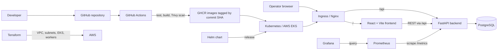
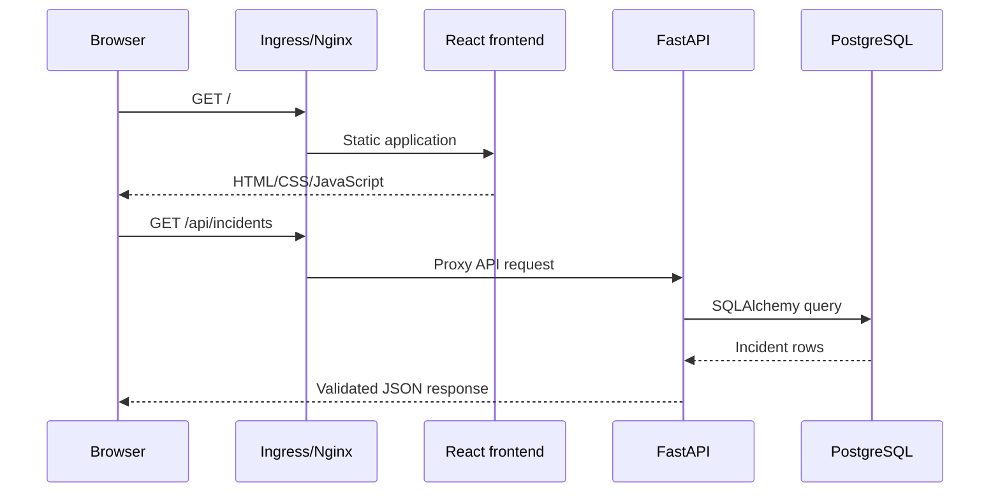
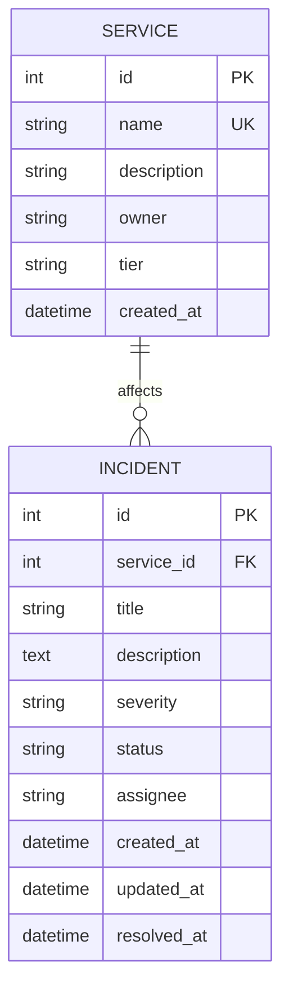
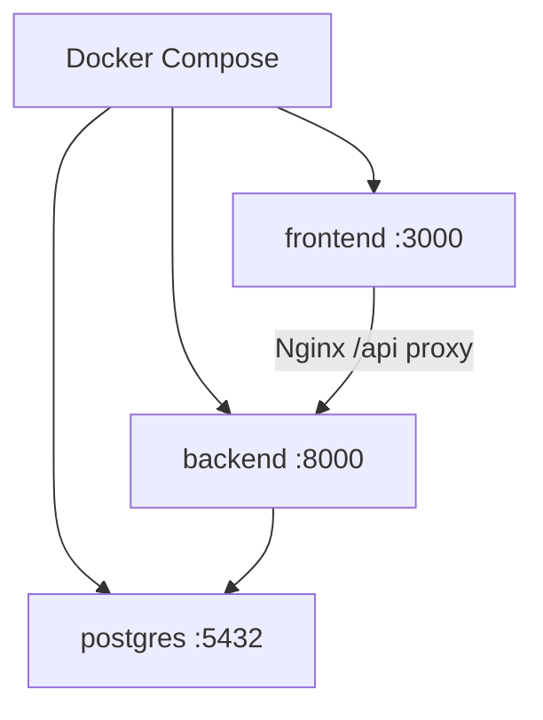
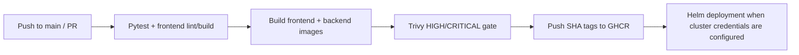

# IncidentOps Architecture

## System purpose

IncidentOps is a cloud incident and service reliability management platform. It records affected services and production incidents, tracks severity/status/ownership, highlights SLA risk, and exposes operational telemetry. Its product model and visual identity are intentionally different from the teacher's TaskBoard reference.

## Context and delivery flow



## Runtime request path



## Application components

### Frontend

- React with Vite; responsive operations dashboard.
- Incident table/cards with severity and status filters.
- Create/edit incident form and lifecycle actions.
- Services view and dashboard KPI/SLA-risk panels.
- Explicit loading, empty, validation, backend-error, and retry states.
- Browser calls same-origin `/api`; it never embeds a cluster-internal hostname.
- Production image uses a multi-stage Node build and non-root Nginx runtime.

### Backend and API

- FastAPI with separated routers, schemas, models, configuration, database, and service logic.
- SQLAlchemy 2.x ORM and Alembic-only schema evolution.
- Pydantic validation constrains severity/status and rejects invalid input.
- `/health` proves the process is alive; `/ready` proves database connectivity; `/metrics` exports Prometheus data; `/docs` exposes Swagger.
- Structured logs go to stdout/stderr for Docker and Kubernetes collection.

Planned API surface:

| Method | Route | Purpose |
|---|---|---|
| GET | `/` | API identity/version links |
| GET | `/health` | Liveness |
| GET | `/ready` | Database-aware readiness |
| GET | `/metrics` | Prometheus metrics |
| GET | `/api/services` | List services |
| POST | `/api/services` | Create a service |
| GET | `/api/incidents` | List/filter incidents |
| GET | `/api/incidents/{id}` | Incident detail |
| POST | `/api/incidents` | Declare an incident |
| PUT | `/api/incidents/{id}` | Update lifecycle/details |
| DELETE | `/api/incidents/{id}` | Delete an incident |
| GET | `/api/incidents/stats` | Dashboard summary |

### Data model



Rules:

- Severities: `P1_CRITICAL`, `P2_HIGH`, `P3_MEDIUM`, `P4_LOW`.
- Statuses: `OPEN`, `ACKNOWLEDGED`, `INVESTIGATING`, `RESOLVED`.
- `resolved_at` is set only when status becomes Resolved and cleared if reopened.
- SLA risk is initially calculated from severity and incident age; no separate workflow engine is needed.
- All timestamps are stored in UTC and rendered in the user's locale.

### PostgreSQL

- Local development runs PostgreSQL in Compose with a named volume.
- Tests use an isolated SQLite database or ephemeral test database.
- Classroom Kubernetes deploys PostgreSQL with a PVC and Kubernetes Secret references.
- RDS is intentionally excluded because the rubric asks for VPC/EKS, while RDS would add cost and operational scope.

## Containers and local development



- Compose includes health checks and dependency readiness, not only startup order.
- Both runtime containers use numeric non-root users.
- No real secrets are baked into images. Local development values are non-production defaults or supplied via untracked environment variables.

## CI/CD and supply chain



- Tests must pass before image work begins.
- Actions and third-party steps use pinned major/release versions and least-privilege permissions.
- Image identity is `ghcr.io/<owner>/incidentops-{frontend,backend}:<full-or-short-commit-sha>`; production deployment never depends on `latest`.
- GitHub's built-in token publishes packages; no personal token is stored when unnecessary.
- Trivy scans both runtime images and fails on HIGH/CRITICAL results. Any exception must be documented and time-bounded, not silently ignored.

## AWS and Terraform

Terraform owns:

- One tagged VPC.
- At least two public subnets across two Availability Zones, as required by the rubric.
- Private subnets only if the final rehearsed design requires them.
- EKS control plane using a currently supported standard-support Kubernetes version.
- One minimal managed worker node group sized only for the demo.
- Security groups, IAM roles/policies, and outputs needed to connect kubectl.

Terraform state stays local for this single-student capstone unless a free/approved remote-state solution is later justified. State, plan binaries, `.terraform/`, kubeconfig, and variable files with values are ignored by Git. No credentials appear in HCL or `terraform.tfvars.example`.

## Kubernetes and Helm

Namespace: `incidentops`.

The chart includes:

- Frontend Deployment and ClusterIP Service, minimum two replicas in grading values.
- Backend Deployment and ClusterIP Service, minimum two replicas, resources, probes, and metrics port.
- PostgreSQL workload, Service, Secret references, and PVC for the classroom demo.
- Ingress routing `/` to frontend and `/api` to the backend Service's actual port.
- Backend HPA using CPU utilization, with CPU requests and Metrics Server prerequisite documented.
- ServiceMonitor selected by kube-prometheus-stack.
- `values-local.yaml` and `values-aws.yaml` so environment differences do not require editing templates.

Secrets are supplied at install time or created outside committed values. The chart will be checked with `helm lint`, `helm template`, server/client dry runs, and real deployment.

## Ingress

- Local: free NGINX Ingress Controller and a hosts-file name such as `incidentops.local`.
- AWS: choose the least-cost controller/path that works in the rehearsed environment and explicitly verify any LoadBalancer charge before creation.
- `/api` is routed before `/`; frontend Nginx also supports same-origin local proxying.
- TLS and a purchased domain are intentionally not required for the rubric; no paid domain is planned.

## HPA and reliability

- Backend starts at two replicas and scales within a conservative maximum.
- CPU requests make utilization meaningful.
- Metrics Server supplies resource metrics.
- Controlled load is generated only against the demo application and stopped after evidence capture.
- Probes use `/health` and `/ready`; they are not interchangeable.

## Monitoring

- `prometheus-fastapi-instrumentator` (or equivalent free library) exposes request count, latency, and status metrics.
- kube-prometheus-stack installs Prometheus and Grafana.
- ServiceMonitor discovers the backend by matching labels and the named metrics port.
- Grafana dashboard is provisioned from source-controlled JSON/ConfigMap, with panels for request rate, latency, and 5xx responses.
- Port-forwarding is preferred for private administrative access during the demo.

## Troubleshooting exercises

Two isolated manifests intentionally create:

1. `ImagePullBackOff` through a nonexistent image tag.
2. A Service with no endpoints through a selector/Pod-label mismatch.

The runbook covers `get`, `describe`, logs, events, labels, endpoints, root cause, correction, and recovery. Faults use separate names and cannot break the main release.

## Planned repository structure

```text
IncidentOps/
├── .github/workflows/ci-cd.yml
├── backend/
│   ├── alembic/versions/
│   ├── app/
│   │   ├── api/
│   │   ├── config.py
│   │   ├── db.py
│   │   ├── main.py
│   │   ├── models.py
│   │   └── schemas.py
│   ├── tests/
│   ├── Dockerfile
│   ├── pytest.ini
│   └── requirements.txt
├── frontend/
│   ├── src/
│   ├── Dockerfile
│   └── nginx.conf
├── helm/incidentops/
│   ├── templates/
│   ├── Chart.yaml
│   ├── values.yaml
│   ├── values-local.yaml
│   └── values-aws.yaml
├── k8s/namespace.yaml
├── monitoring/
├── scripts/
├── terraform/
├── troubleshooting/
├── docker-compose.yml
└── README.md
```

## Cost boundary

All planned development tools and hosted source/package/CI features use free/open-source or free-tier options. AWS is the explicit exception.

Amazon EKS currently charges per cluster-hour, and worker nodes, EBS, public IPv4, and networking are additional. NAT Gateway also charges while provisioned plus data processing. Therefore the architecture is rehearsed locally, created once for grading, observed for only the required evidence window, and destroyed the same session. AWS Budgets alerts are helpful but delayed and are not a hard spending cap; the destroy checklist is the primary control.

Official references: [Amazon EKS pricing](https://aws.amazon.com/eks/pricing/), [Amazon VPC/NAT Gateway pricing](https://aws.amazon.com/vpc/pricing/), and [AWS Budgets pricing](https://aws.amazon.com/aws-cost-management/aws-budgets/pricing/).
