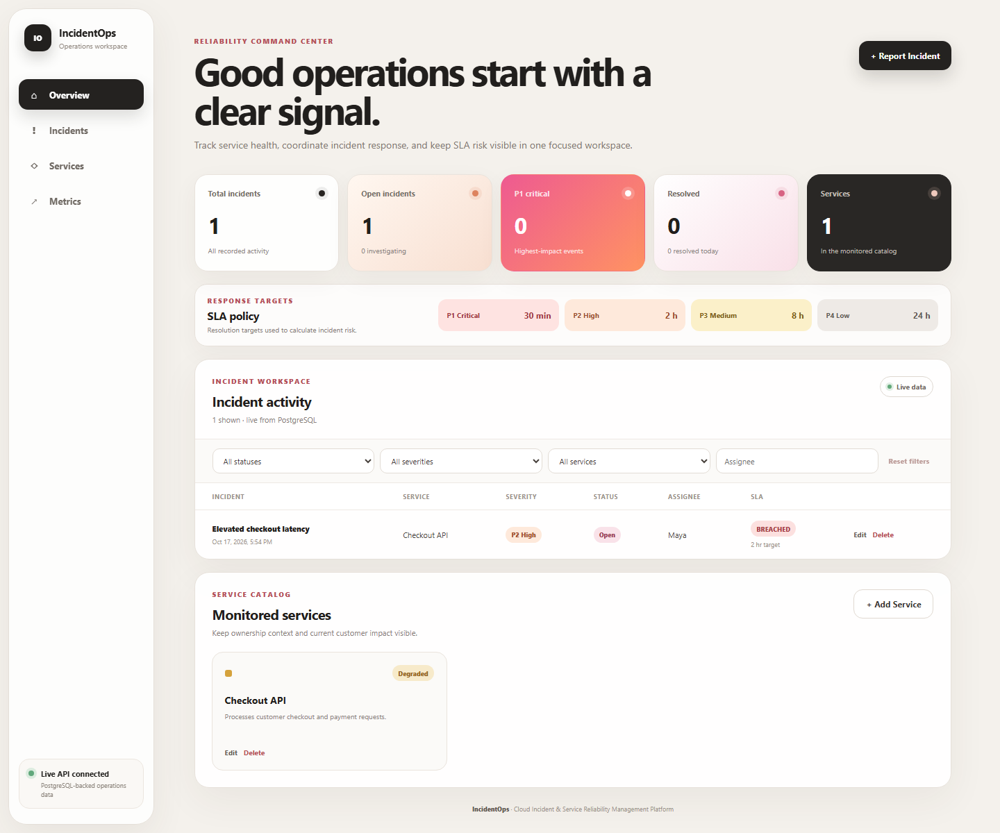
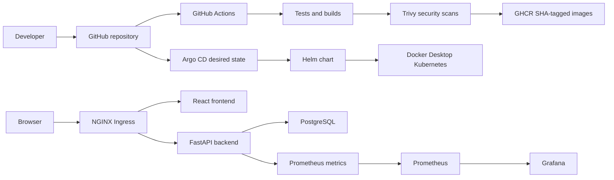
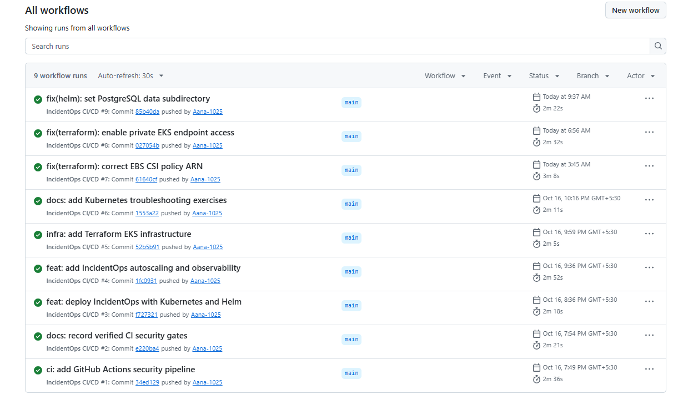
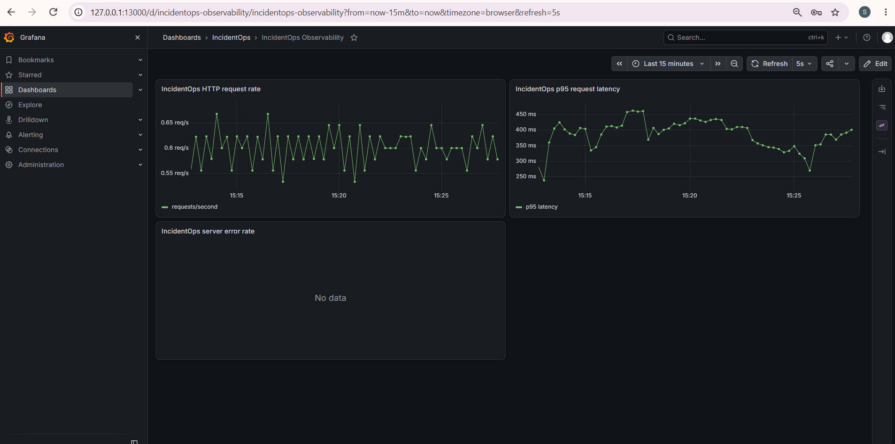

# IncidentOps

I built IncidentOps as my university DevOps capstone project. It is an incident and service reliability management platform where I can register services, report incidents, track their severity and lifecycle, and see operational statistics and SLA risk in one dashboard.

The application is intentionally small enough to understand end to end, but the delivery path is complete: automated tests, non-root containers, GitHub Actions, Trivy, GHCR, Terraform, AWS EKS, Kubernetes, Helm, Argo CD, autoscaling, Prometheus, Grafana, and troubleshooting exercises.



## What the application does

- Creates, lists, updates, filters, and deletes monitored services and incidents.
- Tracks incident severity, status, assignee, timestamps, and affected service.
- Supports the Open, Acknowledged, Investigating, and Resolved lifecycle.
- Calculates SLA deadlines and risk from incident severity and age.
- Shows database-derived dashboard statistics and clear loading, empty, validation, and error states.
- Exposes Swagger documentation, liveness, database-aware readiness, and Prometheus metrics.

## Architecture



I kept `/health` and `/ready` separate because a process can be alive while its database dependency is unavailable. Kubernetes uses `/health` for liveness and `/ready` before routing traffic.

## Technology stack

| Area | Technology |
|---|---|
| Frontend | React 19, Vite, responsive CSS, Nginx |
| Backend | Python 3.12, FastAPI, Pydantic, SQLAlchemy, Alembic |
| Database | PostgreSQL 17 |
| Testing | Pytest, HTTPX, isolated PostgreSQL test database |
| Containers | Docker, Docker Compose, non-root runtime users |
| CI/CD | GitHub Actions, GHCR, immutable Git SHA tags |
| Security | Trivy HIGH/CRITICAL image gate |
| Infrastructure | Terraform, AWS VPC, Amazon EKS |
| Platform | Kubernetes, Helm, Argo CD, NGINX Ingress, HPA |
| Observability | Prometheus, Grafana, ServiceMonitor |

## Repository structure

```text
IncidentOps/
├── .github/workflows/ci-cd.yml
├── argocd/                    # Local GitOps Application definition
├── backend/                    # FastAPI, models, migrations, and tests
├── demo/                       # Final video and presentation artifacts
├── docs/images/                # README application screenshot
├── frontend/                   # React/Vite application and Nginx config
├── evidence/                   # Curated M1-M10 grading evidence
├── helm/incidentops/           # Complete application Helm chart
├── k8s/namespace.yaml
├── monitoring/                 # Prometheus/Grafana Helm values
├── terraform/                  # VPC, EKS, IAM, and EBS CSI infrastructure
├── troubleshooting/           # Isolated failure exercises and runbook
└── docker-compose.yml
```

## Run locally with Docker Compose

Prerequisites are Docker Desktop and Docker Compose. From the repository root:

```powershell
docker compose up --build -d
docker compose ps
```

The stack starts PostgreSQL, applies the Alembic migration before the API starts, waits for backend readiness, and then starts the frontend.

Useful URLs:

- Dashboard: `http://localhost:3000`
- Swagger: `http://localhost:8000/docs`
- Liveness: `http://localhost:8000/health`
- Readiness: `http://localhost:8000/ready`
- Metrics: `http://localhost:8000/metrics`

Stop the stack with `docker compose down`. The named PostgreSQL volume is retained unless it is explicitly removed.

## API and database

The main REST collections are `/api/services` and `/api/incidents`. Both support GET, POST, PUT, and DELETE operations; incidents also support filters and `/api/incidents/stats`.

SQLAlchemy owns the runtime models and Alembic owns schema changes. The initial migration creates the `services` and `incidents` tables, indexes incident status/severity/service, and enforces the service foreign key. PostgreSQL is published as `localhost:5433` for host development because port 5432 belongs to an unrelated local process. Containers use Docker DNS at `postgres:5432`.

## Testing

The backend contains 16 Pytest tests covering health, readiness, service CRUD, incident CRUD, validation, missing records, service linkage, resolution timestamps, statistics, and SLA calculations.

```powershell
docker compose up -d postgres
cd backend
.venv\Scripts\python -m pytest -v
```

Tests are protected from the development database: the configured database name must end in `_test`, the real Alembic chain is applied to it, and rows are cleared before and after each test.

## Docker design

The backend image runs as UID/GID `10001`, and the frontend uses a Node build stage followed by the unprivileged Nginx runtime as UID/GID `101`. I used a multi-stage frontend build so Node and development dependencies are not included in the runtime image. Running both application containers as non-root reduces the impact of a container compromise.

Compose health checks verify PostgreSQL, database-aware backend readiness, and frontend HTTP availability instead of checking only whether a process started.

## CI/CD, GHCR, and Trivy

Every push to `main` and pull request targeting `main` runs the GitHub Actions pipeline. The quality job starts an ephemeral PostgreSQL service, runs all backend tests, then runs frontend lint and the production build. A second job builds both images, scans them, and publishes only successful `main` builds.



Published images use the full commit SHA:

```text
ghcr.io/aana-1025/incidentops-backend:<full-git-sha>
ghcr.io/aana-1025/incidentops-frontend:<full-git-sha>
```

I chose immutable SHA tags instead of `latest` so a deployed container can always be traced to the source commit that built it. Trivy scans operating-system and language packages in both runtime images. A known `HIGH` or `CRITICAL` vulnerability returns a failing exit code, so an unsafe image is not published silently. The captured final scans were clean at those blocking severities.

## Terraform and the completed AWS evidence run

Terraform defines a dedicated `10.0.0.0/16` VPC, two public subnets in separate Availability Zones, an Internet Gateway and route table, EKS IAM roles, one managed node group, the EKS Pod Identity Agent, and EBS CSI support. I avoided NAT Gateway and RDS because they were not required for the academic workload and would add unnecessary hourly cost. The EKS public endpoint was restricted to the operator's current `/32`; private endpoint access was also enabled for reliable worker registration.

The AWS evidence session was genuinely completed in `ap-south-1`:

- The initial Terraform plan was **21 to add, 0 to change, 0 to destroy**.
- The VPC, two public subnets, EKS 1.36 cluster, managed node group, and one `t3.medium` worker were created.
- EKS and the node group became Active, and the worker became Ready.
- EBS CSI and Pod Identity were configured.
- IncidentOps was deployed with Helm; Ingress, the API, and the PostgreSQL PVC worked.
- Screenshots and video were captured before cleanup.
- Application Kubernetes resources were removed, followed by Terraform-managed infrastructure.
- Final destroy output was **0 added, 0 changed, 21 destroyed**.
- `terraform state list` was empty after cleanup.

No project AWS application or EKS environment is running now. The original Terraform state/backups remain local and Git-ignored as historical operational records.

See [terraform/README.md](terraform/README.md) for architecture, safe reproduction steps, cost warnings, and the verified run summary.

## Kubernetes and Helm

The Helm chart deploys two frontend replicas, two backend replicas, one PostgreSQL StatefulSet, ClusterIP Services, a migration Job, Ingress, a backend HPA, and a ServiceMonitor. I used Helm so configuration, upgrades, and rollbacks are reproducible rather than a sequence of manual Kubernetes edits.

```powershell
helm lint .\helm\incidentops -f .\helm\incidentops\values-local.yaml
helm template incidentops .\helm\incidentops -n incidentops `
  -f .\helm\incidentops\values-local.yaml
```

NGINX Ingress routes `/` to the frontend and `/api` to the backend. The frontend then keeps browser API calls same-origin.

PostgreSQL uses a 1 GiB `ReadWriteOnce` PVC. Its `PGDATA` points to a subdirectory so dynamically provisioned filesystems containing `lost+found` work correctly. A revision-scoped Helm migration Job runs `alembic upgrade head` once, while backend init containers wait for the database schema to reach the Alembic head.

## Argo CD and GitOps

GitHub Actions is the CI and image-publishing path: a push runs tests and builds, scans both images with Trivy, and publishes immutable SHA tags to GHCR. It does not deploy to Kubernetes.

The final GitOps supplement installs Argo CD on Docker Desktop and uses the source-controlled [`argocd/application.yaml`](argocd/application.yaml) to reconcile this repository's Helm chart into the isolated `incidentops-gitops` namespace. Automated sync, pruning, and self-healing are scoped to that namespace. Both application images are pinned to the verified M10 SHA `2b76fa3c3b1c580fe48d4b3b5504c4206793061d`; Ingress, HPA, and ServiceMonitor creation are disabled for the supplement so it cannot conflict with the existing `incidentops` release.

The historical M10 deployment remains a controlled manual Helm upgrade, and the earlier AWS/EKS demonstration did not use Argo CD. The local supplement proves the separate Git desired state to Argo CD to Helm to Kubernetes flow without recreating AWS infrastructure.

## Autoscaling and observability

The backend HPA starts at two replicas, scales to five, and targets 50% CPU utilization. CPU requests are defined because Kubernetes needs them to calculate utilization, and Metrics Server supplies the resource metrics. During local verification, controlled load scaled the backend from 2 to 4 and then 5 replicas.

Prometheus discovers the backend through a ServiceMonitor and scrapes `/metrics`. Grafana is provisioned from source-controlled values with request-rate, p95-latency, and server-error panels.



The evidence shows both backend Prometheus targets UP and populated request-rate and p95-latency panels.

## Troubleshooting exercises

The `troubleshooting/` directory contains isolated exercises that do not modify the Helm-managed application:

1. A nonexistent image tag produces `ImagePullBackOff`; Pod status, descriptions, and events identify the cause.
2. A Service forwards to the wrong target port; the Pod is healthy but the Service request fails until `targetPort` is corrected.

The [runbook](troubleshooting/RUNBOOK.md) records diagnosis, recovery, and cleanup commands. Both failures were reproduced, diagnosed, and recovered during verification.

## Security and cost controls

- Real credentials, `.env`, kubeconfig, Terraform state, plans, and local tfvars are ignored.
- GitHub Actions uses the repository token with read-only defaults and grants package write access only to the publishing job.
- Containers run as non-root users.
- Images are promoted only after tests, builds, and Trivy pass.
- The Kubernetes API was never opened to `0.0.0.0/0`.
- The AWS design intentionally excluded NAT Gateway, RDS/Aurora, ElastiCache, Elastic IPs, Route 53 zones, and AWS Load Balancers.
- The paid AWS environment was timeboxed and destroyed after evidence capture.

Development database passwords in Compose and default Helm values are classroom-only placeholders, not production credentials.

## Evidence and final status

Detailed evidence is organized by rubric module in [evidence/README.md](evidence/README.md). The external original capture folder is preserved separately; the repository contains only a reviewed curated copy.

For my final deployment demonstration, I made a small visible UI change by adding an SLA policy quick reference, pushed it to `main`, and let the normal GitHub Actions pipeline test, scan, and publish new SHA-tagged images. I then upgraded the local Docker Desktop Helm release to that exact application commit, verified both deployed image SHAs, and confirmed the change and live data through the browser and API. This final M10 deployment was local; it did not recreate the earlier AWS environment.

Final verified status:

- 16 backend tests pass.
- Frontend lint and production build pass.
- Compose starts three healthy services with non-root application containers.
- GitHub Actions builds, scans, and publishes both SHA-tagged images.
- Local Kubernetes, Helm, Ingress, PVC, HPA, Prometheus, Grafana, and troubleshooting flows were verified.
- AWS VPC/EKS deployment and application operation were verified, then all project infrastructure was destroyed successfully.
- The M10 application release is `2b76fa3c3b1c580fe48d4b3b5504c4206793061d`; GitHub Actions run [#11](https://github.com/Aana-1025/incidentops-devops-capstone/actions/runs/39031611188) passed, and Helm revision 6 ran both application images at that SHA.
- Final M10 deployment and CRUD evidence is indexed in [evidence/M10-demo/README.md](evidence/M10-demo/README.md).

## Demo and presentation

- [Final Demo Video](demo/IncidentOps_Final_Demo_Antara_Utane.mp4)
- [Presentation — PPTX](demo/IncidentOps_Presentation_Antara_Utane.pptx) — 13 slides, including the final local Argo CD GitOps demonstration

## Scope and limitations

- IncidentOps is an academic reliability-management platform, not a production PagerDuty replacement.
- Authentication, RBAC, and multi-tenancy are outside this capstone scope.
- PostgreSQL runs inside Kubernetes for the demonstration instead of using a managed production database.
- The AWS environment was intentionally timeboxed and destroyed after evidence collection.
- The final Argo CD GitOps demonstration runs locally on Docker Desktop rather than recreating AWS.
- CI publishes immutable images; image versions are pinned explicitly instead of using an automated image updater.

## Author

Antara Utane

Email: [antarautane11@gmail.com](mailto:antarautane11@gmail.com)
